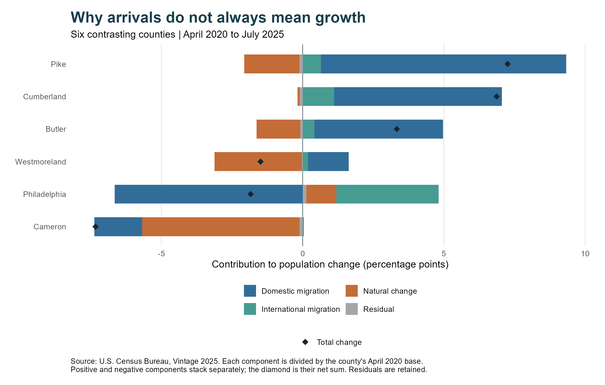

## Motivation and Research Question

When we realized a place losing population, we will more likely to imagine people are packing up stuff, moving towards another place. However, Is that always happening? Does population declining always means there are more people moving out, compared with moving in? A county can gain residents through migration and still become smaller if deaths exceed births by a larger amount. This made me curious about Pennsylvania: which counties are growing, and how much does migration contribute to the differences across the state?

## Data and Methodology

I use the Census Bureau's [Vintage 2025 county population estimates](https://www.census.gov/data/tables/time-series/demo/popest/2020s-counties-total.html), covering all 67 Pennsylvania counties. The comparison runs from April 1, 2020 to July 1, 2025. I downloaded the data in R and joined them to Census county boundaries using five-digit geographic codes. All 67 counties matched. Both interactive maps use simplified 2023 county boundaries. The downloadable static maps use an equal-area projection; the interactive maps use Web Mercator. Neither measure is calculated from land area.

To compare counties of different sizes, I calculate cumulative population change as a percentage of the April 2020 estimates base:

$$
\text{Population change (\%)} =
\frac{\text{Population}_{2025}-\text{Population base}_{2020}}
{\text{Population base}_{2020}}\times100.
$$

Natural change refers to  births minus deaths. Net migration includes domestic and international net migration. Domestic migration includes moves between Pennsylvania counties as well as moves to and from other states. I sum the components over the same period and divide each by the starting population, to calculate cumulative contributions. The [Census field documentation](https://www2.census.gov/programs-surveys/popest/technical-documentation/file-layouts/2020-2025/CO-EST2025-ALLDATA.pdf) also identifies a residual, which I keep so that the components add up to total change.

## A Small Statewide Increase Hides Different Local Stories

Pennsylvania's population increased by 56,679 people,about 0.44%, over these period. It seems like there is only a tiny change. However, the map shows that the statewide number combines growth in some places with decline in many others.26 counties grew, while 41 lost population.

Hover over a county to see its figures, or click to keep the information open. Drag to move the map and use the **+ / −** buttons to zoom. Blue indicates growth; orange indicates decline.

<iframe src="figures/population_change.html" title="Interactive Pennsylvania county population change map" style="width:100%;height:580px;border:1px solid #dde3e6;border-radius:6px;" loading="lazy"></iframe>

[View static map](figures/population_change.png)

Growth is more obvious across parts of the eastern and south-central areas. Many western and northern counties'populatoin were declined. Pike, which is the county in the northeast, had the largest percentage increase at 7.3%, followed by Cumberland at 6.9%. In contrast, Cameron lost 7.3% of its population.

Also, this is not a simple east-versus-west division. Butler grew by 3.3% in western Pennsylvania. While Philadelphia declined by 1.8% in the southeast. The map therefore gives us a more useful picture than the statewide average, but it does not yet explain what lies behind those differences.To understanding the change of population in pennsylvania better, we need to figure out the reasons behind it.

## Gaining Residents Through Migration Is Not Always Enough

The second map asks where migration added population. It uses the same color scale as the first map, so the two patterns can be compared directly.

<iframe src="figures/net_migration.html" title="Interactive Pennsylvania county net migration map" style="width:100%;height:580px;border:1px solid #dde3e6;border-radius:6px;" loading="lazy"></iframe>

[View static map](figures/net_migration.png)

There is clearly more blue on this map. 45 counties had positive net migration, but only 26 counties grew overall. In fact, 19 counties lost population despite gaining residents through net migration. This difference matters: population decline alone cannot be seen as more people moved out than moved in directly.

Raise Westmoreland as an example, net migration added 5,762 people on population, but deaths exceeded births by 10,953. After including the small residual adjustment, its population fell by 1.5%. Migration softened the decline, but did not offset the natural decrease.

Butler shows a different situation nearby. It also had more deaths than births, but its net migration gain of 9,614 exceeded its natural decrease of 3,005. Its population grew. The difference between these two counties is not whether they gained residents through migration, but is whether those gains were large enough to offset the other component.

## Different Routes to Growth—and Decline

To examine the differences more closely, the final figure separates natural change, domestic migration, international migration, and the residual for six contrasting counties. These examples were selected to illustrate different patterns. Bars show contributions relative to the starting population; the diamond shows the overall percentage change.

{width="100%"}

Pike and Cumberland both grew despite having more deaths than births. Domestic net migration was the largest positive component in each. It contributed about 8.7 percentage points in Pike, and 5.9 percentage points in Cumberland. International migration also added population. These examples show how migration can support growth even when natural change is negative.

Philadelphia tells a different story. Natural change contributed approximately 1.1 percentage points, and international migration added 3.6 percentage points. However, domestic net migration contributed −6.7 points, outweighing those gains. Looking only at total net migration would hide these opposing flows. The figures do not tell us where departing residents went, so we cannot conclude that they moved to the growing counties shown on the map.

Cameron's decline involved both natural decrease and net outmigration, with natural decrease contributing the larger share. Its large percentage loss also needs to consider the initial scale of the location. Cameron started with only 4,544 residents, and the decline was 333 people. A dark color on a percentage map does not necessarily identify the place losing the largest number of residents since our map shows percentage change.

## Key Takeaways

The main finding is that population decline does not always mean net outmigration. 59 of Pennsylvania's 67 counties experienced natural decrease. Migration offset that pressure sufficiently for 19 of those counties to grow, while other counties continued to shrink despite net inflows.

At the state level, international net migration added 196,721 people, while domestic net migration was −54,290 and natural change was −89,333. Together with the residual, these components produced the modest overall increase. The county maps show how unevenly that balance was distributed.

For local planning, this distinction suggests different questions. A growing county may need to examine how housing and services can accommodate additional residents. A shrinking county with positive net migration needs to consider natural decrease as well as population movement. These figures identify which demographic components deserve attention

## Limitations and Conclusion

These are population estimates, which can be revised, and this analysis does not present confidence intervals. County averages hide differences within counties, while larger geographic areas occupy more space on the map regardless of their population. The cumulative comparison also hides annual changes during a period that included the pandemic. Finally, the data describe net flows rather than individual reasons for moving. They cannot establish whether jobs, housing costs, or other conditions caused a county's growth or decline.

In conclusion, Pennsylvania's small statewide increase contains several different local stories. Migration supported growth in some counties, reduced decline in others, and pulled in opposing directions in Philadelphia. To understand where population is changing, we need both the map of the outcome and the demographic components behind it.

## Data Sources

- U.S. Census Bureau, Population Division. *Annual Resident Population Estimates and Components of Change for States and Counties: April 1, 2020 to July 1, 2025*, Vintage 2025, released March 2026. [Data and documentation](https://www.census.gov/data/tables/time-series/demo/popest/2020s-counties-total.html).
- U.S. Census Bureau. *2023 Cartographic Boundary File: Counties, 1:5,000,000*. [Boundary download](https://www2.census.gov/geo/tiger/GENZ2023/shp/cb_2023_us_county_5m.zip).

Files accessed October 17, 2026. The [BLOG5 repository](https://github.com/annzhao-77/BLOG5) contains the input snapshots, R script, and generated tables supporting the figures and numbers above.
