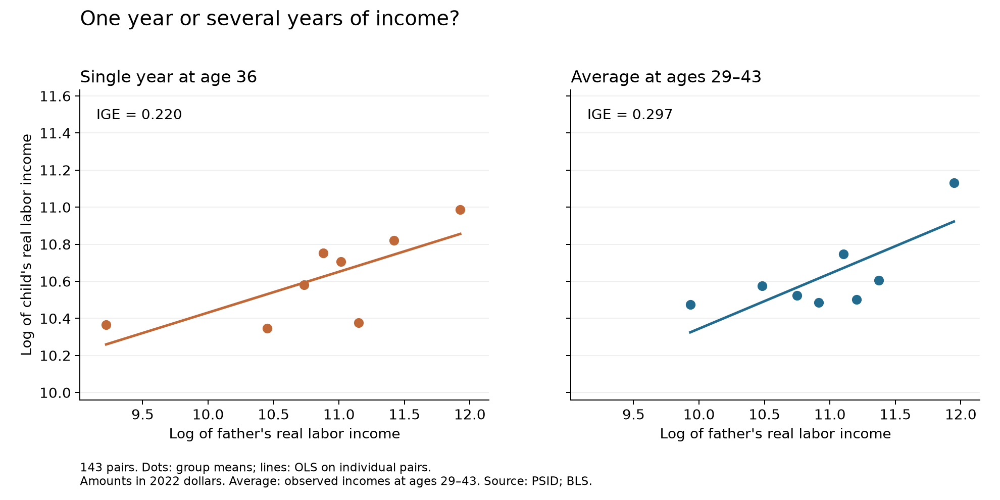

## Motivation and Research Question

I recently started learning SQL and found it useful for connecting tables and organizing data. In this tutorial, I share what I learned through a practical question: **Do higher-income fathers tend to have higher-income children?** We will use SQL to match fathers with their adult children and construct income measures, then use Python to estimate the relationship.

## Data and Method

I use the [Panel Study of Income Dynamics](https://psidonline.isr.umich.edu/) and its Family Identification Mapping System (FIMS). Here, “children” refers to the fathers’ adult sons and daughters. I use the 1994–2023 survey waves, which report income for 1993–2022. The labor-income variables selected for these waves exclude farm and unincorporated business income. Earlier measures for household heads included these components. To avoid mixing different income definitions, I restrict the analysis to the 1994–2023 surveys.

We estimate a simple log regression:

$$
\log(Y_{child,i})=\alpha+\beta\log(Y_{father,i})+\varepsilon_i.
$$

The slope $\beta$ is the intergenerational income elasticity (IGE): a 1% difference in fathers' income is associated with approximately a $\beta$% difference in children's income.

First, we use income measured at approximately age 36 for both fathers and children. We estimate age in the income year by subtracting one from survey age because income refers to the previous year. Among ages 30–45, age 36 gives us the most father-child pairs with enough data for both models. Fathers and children usually reach this age in different calendar years, so we convert their incomes to 2022 dollars using [BLS CPI-U](https://www.bls.gov/developers/): multiply each amount by $CPI_{2022}/CPI_{income\ year}$.

**Life-cycle bias** can arise when we use income at one age to represent lifetime income. People who spend more years in school may earn little when young but much more later. Measuring children’s income too early can therefore bias the IGE downward, making income persistence appear weaker. However, life-cycle bias can be upward or downward, depending on when income is measured and how earnings change over time. Even when fathers and children are measured at the same age, they may be at different career stages. Averaging several years helps smooth temporary income fluctuations and provides a better proxy for long-term income ([Mazumder, 2018](https://pmc.ncbi.nlm.nih.gov/articles/PMC6820674/)).

To better approximate long-term income, our second regression uses each person’s average real income at **ages 29–43**. We calculate this average before taking logs. Each person must have at least three income observations, allowing us to use repeated measurements while retaining enough matched pairs. The number of available observations varies because surveys are not conducted every year in the later period and some records are unavailable. In our sample, the averages use 6.4 observations for fathers and 5.1 for children, on average.


## 1. Connect Fathers and Children

The complete workflow is available in [`code/analysis.py`](https://github.com/annzhao-77/BLOG6/blob/main/code/analysis.py). To follow along, place your downloaded PSID files in `data/raw/` and follow the [README instructions](https://github.com/annzhao-77/BLOG6/blob/main/README.md).

Python first reads the files and prepares four SQLite tables:

| Table | Contents |
|---|---|
| `people` | One row per person, with a permanent ID |
| `relationships` | Child and biological father IDs from FIMS |
| `person_year` | Each person’s age, family ID, household role, and income fields by survey year |
| `cpi` | Annual CPI values for inflation adjustment |

The permanent person ID combines the 1968 family ID and person number, allowing us to identify the same person across years.

We start with the father-child links in `relationships`. We check both IDs against `people` to keep pairs where both individuals appear in our income extract:

```sql
CREATE TABLE father_child AS
SELECT DISTINCT r.child_id, r.father_id
FROM relationships AS r
JOIN people AS c ON r.child_id = c.person_id
JOIN people AS p ON r.father_id = p.person_id;
```

`CREATE TABLE` saves the result as `father_child`, and `SELECT` chooses the two IDs. The first `JOIN` checks for the child; the second checks for the father. The aliases `r`, `c`, and `p` identify the tables used in each comparison. `DISTINCT` removes duplicate pairs, leaving one row per father-child pair for the next step.

## 2. Find Their Own Income

The `person_year` table contains each person's household role. We select the corresponding income field:

```sql
SELECT person_id, survey_year,
       CASE
           -- Current reference person (formerly called Head):
           -- sequence number 1 and relationship code 10
           WHEN sequence_number = 1 AND relationship = 10
               THEN head_income

           -- Current spouse or partner:
           -- sequence number 2; relationship 20 = spouse, 22 = partner
           WHEN sequence_number = 2 AND relationship IN (20, 22)
               THEN spouse_income
       END AS nominal_income
FROM person_year
WHERE family_id > 0;
```

Now that we have matched fathers and children, we need to find each person’s own income. `CASE` selects the appropriate income field based on their household role. For example, an adult child recorded as a spouse needs the spouse-income field. `WHERE` keeps records with a valid family ID. The full script then adjusts income using CPI.

## 3. Build Average Income and Match Again

The single-year regression selects age 36. For the average income model, we need to use SQL to group income records by person:

```sql
CREATE TABLE averages AS
SELECT person_id, AVG(real_income) AS mean_income,
       -- Record how many income observations contribute to each average
       COUNT(*) AS n_years
FROM income
WHERE age BETWEEN 29 AND 43
GROUP BY person_id
HAVING COUNT(*) >= 3;
```

`GROUP BY` collects each person’s records. `AVG()` calculates their average income, while n_years records its observation count. `HAVING` keeps only people with at least three observations.

We now have two tables: father_child contains the father-child ID pairs, and averages contains each person’s average income. We connect them so that each pair’s two incomes appear on the same row:

```sql
SELECT f.child_id, f.father_id,
       p.mean_income AS father_average,
       c.mean_income AS child_average
FROM father_child AS f
-- Find the father's average income using his ID
JOIN averages AS p ON f.father_id = p.person_id
-- Find the child's average income using their ID
JOIN averages AS c ON f.child_id = c.person_id;
```
The result places each father-child pair and their average incomes on one row. In `code/analysis.py`, additional joins add both incomes at age 36. Both regressions use the same pairs, requiring all four income measures to be positive before taking logs. Zero-income observations are included when calculating averages.


## 4. Estimate in Python

Python fits OLS with an intercept:

```python
import numpy as np
from statsmodels.api import OLS, add_constant

x = add_constant(np.log(sample["father_mature"]))
y = np.log(sample["child_mature"])
model = OLS(y, x).fit()
```

The coefficient on the father’s log income is the IGE. Replacing these age-36 income columns with `father_average` and `child_average` gives the estimate using multiyear average income.

## Results and Takeaway

<!-- RESULTS_START -->
Both models use **143 pairs and 123 fathers**.

| Income measure | IGE |
|---|---:|
| Single year at age 36 | 0.220 |
| Average at ages 29–43 | 0.297 |


<!-- RESULTS_END -->

Both models show that higher-income fathers tend to have higher-income children. The IGE is **0.220** using single-year income and **0.297** using average income, suggesting stronger persistence when income is measured over several years. However, the difference cannot be attributed solely to life-cycle bias: averaging also smooths temporary income fluctuations, and we do not observe lifetime income to determine which estimate is closer to the lifetime IGE.

## Limitations

- **Limited sample:** To avoid mixing income definitions across the 1994 survey change, we use only the 1994–2023 surveys. This limits how many father-child pairs have income records at the same age.
- **Partial income coverage:** Income records span about eight years per person on average, and later surveys occur every two years. Our averages therefore cover only part of each person’s working life and serve as proxies for lifetime income, rather than complete measures of it.
- **Differences across periods:** CPI adjustment makes incomes comparable in purchasing power, but it does not account for changes in labor-market conditions between the years when fathers and children were observed.
