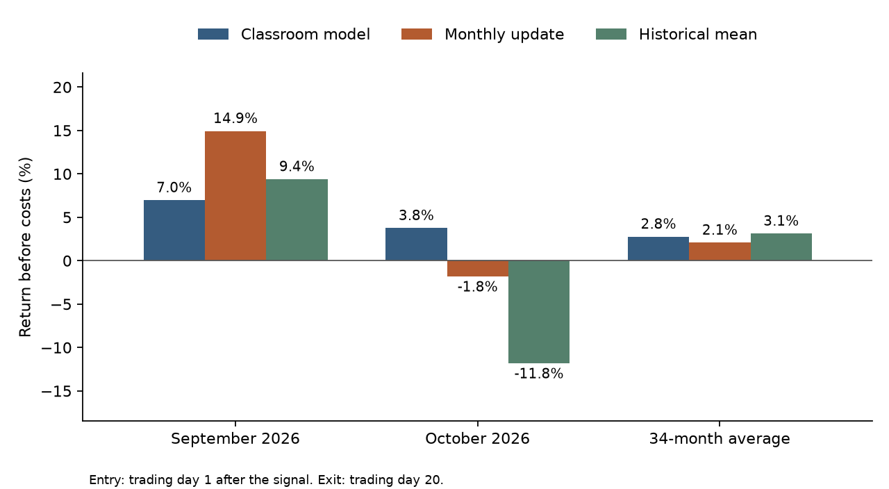

## Motivation

For my first portfolio in class, I relied on my intuition to pick five stocks and decide how much to invest in each. For my second portfolio, I kept the same five stocks and used their past monthly returns to find the weights that maximized the historical Sharpe ratio. This ratio measures excess return above the risk-free rate per unit of volatility. My allocation to GOOGL rose from about 25% to 31%. GOOGL then fell about 18% during the holding period, so I lost more on that stock than I would have with my original allocation.

That experience made me want to try a different way of using price history. Our instructor had shared an optional XGBoost model that forecasts stock returns and uses those forecasts to select ten stocks. For this post, I tried the model and changed how often it trains. The original model trains once. My version starts with the same data and retrains each month, adding the returns that have become available since the last update. I wanted to answer two questions. **Does monthly retraining make the forecasts more accurate? Does the updated model select a portfolio that earns a higher return than the original model’s portfolio?**

## Methodology

I used daily price data from Yahoo Finance for the 95 large U.S. stocks in the classroom model, starting in January 2022. On each prediction date, the model uses recent price changes, volatility, and each stock’s performance relative to the market. It estimates the return from buying a stock on the first trading day after the forecast and selling it on the twentieth. Both prices are measured at the end of the trading day. [Price data](https://finance.yahoo.com/quote/SPY/history/)

The classroom model uses gradient boosting. It starts with a simple forecast and adds one decision tree at a time. Each new tree looks for patterns in the errors made so far. For example, if the model tends to overestimate returns for stocks with large daily price swings, the next tree can adjust those forecasts downward. By repeating this process, the model learns how to use stock characteristics to better predict returns in the training data.

I kept the classroom inputs and tree settings. The original model trains once using outcomes available before January 2024. My version starts with the same history and trains again on the first trading day of each month, adding only examples whose returns are already known. A late-December forecast whose outcome falls in January, for example, cannot enter the initial training set.

I compared both models with a simple benchmark. For each stock, the benchmark predicts its return using the average of its past returns over the same holding period. I measured forecast accuracy using mean absolute error (MAE).

$$
\mathrm{MAE}
= \frac{1}{N}\sum_{i=1}^{N}
\left| \hat{r}_i - r_i \right|
$$

Here, $\hat{r}_i$ is the predicted return and $r_i$ is the actual return for one stock on one prediction date. Both returns are expressed as percentages. For example, a predicted gain of 2% and an actual loss of 1% give an absolute error of $|2 - (-1)| = 3$ percentage points. I averaged these errors across all $N = 3{,}230$ predictions for each model.

Then, I followed the classroom investment rule. Each month, each forecasting method selects its ten highest-ranked stocks and divides the money in proportion to their positive predicted returns. If all ten predictions are nonpositive, each stock receives 10%. I select stocks on the first trading day of each month. Counting from that signal, I buy at the close of trading day 1 and sell at the close of trading day 20. I multiply each stock return by its initial portfolio weight and add those contributions to get the monthly portfolio return. Each month receives equal weight in the average.

## Results

From January 2024 through October 2026, I evaluated 3,230 forecasts per model. Monthly retraining reduced MAE from 6.71 to 6.66 percentage points. The historical average had the lowest MAE at 6.42 percentage points.



From September 2 to September 30, the monthly update returned 14.94% and the original model returned 6.97%. From October 2 to October 29, the monthly update returned -1.79% and the original returned 3.76%.

Across all 34 holding periods, the original model averaged 2.77%, the monthly update 2.08% and the historical average strategy 3.12% per period. The updated model beat the original in 17 periods by an average of 2.65 percentage points. It trailed in 16 periods by an average of 4.27 points. The models tied once.

## Key Takeaways

In this test, adding new data and retraining the model each month made its forecasts slightly more accurate overall. However, better forecasts across all 95 stocks did not lead to higher portfolio returns. Over 34 holding periods, the updated model earned an average return of 2.08%, compared with 2.77% for the original model. For example, a more accurate forecast for a stock outside the top ten lowers the average forecast error without affecting the portfolio’s return.

In October, the updated model ranked two chipmakers first and second: Micron and AMD. Together they accounted for 41% of the portfolio. Between October 2 and 29, Micron fell 13.1% and AMD fell 10.7%. Those two positions alone reduced the portfolio return by about five percentage points. Other holdings offset part of the loss, and the portfolio finished down 1.79%. Invesco identified concerns about AI investment as one factor weighing on U.S. stocks that month. [October market review](https://www.invesco.com/content/dam/invesco/emea/en/pdf/mmr-nov-cov-oct-2026.pdf)

## Limitations

- **Unexpected news.** The model ranks stocks using prices and trading volume available on the signal date. A shift in investor sentiment after that date can leave several top picks exposed to the same decline.

- **Sample and time period.** The test covers 95 large U.S. stocks over 34 holding periods. Testing other years and smaller companies would help show whether the historical average strategy performs as well in other settings.
- **Trading costs.** The reported returns exclude trading costs. If one strategy buys and sells more each month, those costs could reduce its returns more. I would need to compare the amount traded by each strategy to estimate the effect.

